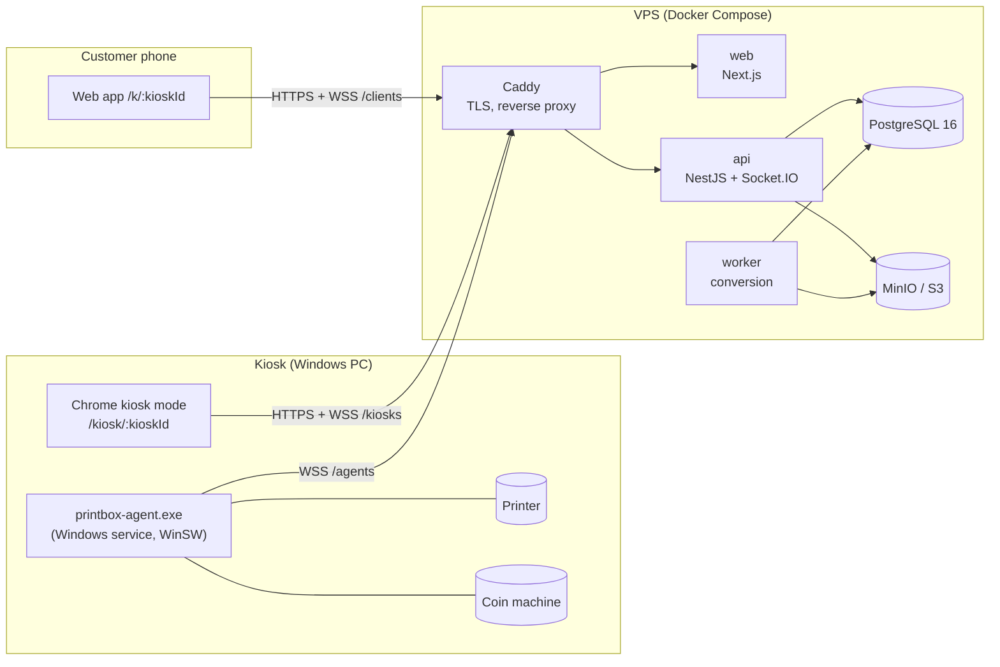

# PrintBox — DevOps strategy

> Status: **draft**, written at the end of Phase 6 (customer web app). Sections marked
> _planned_ describe work scheduled in Phases 7–9 or after; everything else exists in the
> repository today. Update this document as each phase lands, then share it.

## 1. Goals and constraints

PrintBox is self-service printing: a customer scans a QR code on a kiosk, uploads a document
from their phone, pays with coins at the kiosk (or at the counter as a fallback), and collects
the pages. The DevOps strategy serves five goals, in this order:

1. **Never lose or double-charge a customer's money.** Coin events are idempotent, the agent
   never reprints a job, and every state change is audited. Operations must protect these
   guarantees (no manual database edits, backups, careful migrations).
2. **Never keep a customer's file longer than needed.** Files are deleted once printed,
   cancelled, expired or definitively failed, with a 2-hour safety purge (Phase 8). No file
   name or content ever appears in logs, metrics or backups.
3. **Kiosks keep working on poor networks.** The agent has a persistent outbox; the kiosk
   screen and the phone reconnect by themselves. A kiosk that cannot work shows "out of
   service" instead of taking coins.
4. **A small team can run it.** One VPS, Docker Compose, Caddy, GitHub Actions: no
   Kubernetes, no managed services that need a dedicated operator.
5. **Every change is reproducible and reversible.** Everything is in Git, images and
   downloads are pinned, and every release can be rolled back.

Constraints: low budget, customers on slow 4G, Windows PCs at the kiosks, physical hardware
(printer, coin machine) that fails in physical ways, and personal data that is subject to
data protection law (to be confirmed with counsel: Tunisian organic law 2004-63 / INPDP if
operating in Tunisia, GDPR for any EU customers).

## 2. System overview

| Component                                 | Runs where    | Ships as                           | State                             |
| ----------------------------------------- | ------------- | ---------------------------------- | --------------------------------- |
| `web` (customer app, kiosk screen, admin) | VPS           | Docker image                       | stateless                         |
| `api` (REST + Socket.IO, scheduler)       | VPS           | Docker image                       | stateless (one replica: see §7.4) |
| `worker` (LibreOffice/Poppler conversion) | VPS           | same image as `api`                | stateless                         |
| PostgreSQL 16                             | VPS           | official image, pinned by digest   | **system of record**              |
| MinIO (S3)                                | VPS           | Chainguard image, pinned by digest | short-lived files only            |
| Agent                                     | each kiosk PC | signed `.exe` + WinSW service      | outbox and ledger on disk         |
| Kiosk screen                              | each kiosk PC | Chrome `--kiosk` shortcut          | display key in local storage      |

## 3. Environments

| Environment                 | Purpose                  | How it runs                                                               | Data                                        |
| --------------------------- | ------------------------ | ------------------------------------------------------------------------- | ------------------------------------------- |
| **Local**                   | development              | `pnpm db:up` (Postgres + MinIO in Docker), `pnpm dev`                     | seed data, fake printer, simulated coins    |
| **CI**                      | every push and PR        | GitHub Actions, Postgres service, Testcontainers                          | throwaway                                   |
| **Staging** _(planned)_     | release rehearsal, demos | same Compose stack as production on a small VPS, own domain (`staging.…`) | synthetic only, `PAYMENT_FREE_MODE` allowed |
| **Production**              | customers                | VPS, Docker Compose + Caddy                                               | real                                        |
| **Kiosk bench** _(planned)_ | hardware tests           | one real kiosk PC + printer + coin machine connected to staging           | synthetic                                   |

Rules:

- Production and staging never share secrets, databases, buckets or kiosk keys.
- `PAYMENT_FREE_MODE` is refused in production by configuration validation.
- Real customer data never leaves production (no production dumps in staging or on laptops).

## 4. Source control and workflow

- **Trunk-based**: `main` is always releasable. Short-lived branches (`feat/…`, `fix/…`)
  merged through pull requests once the team grows. Until then, direct pushes to `main` are
  allowed, and CI must stay green.
- **Branch protection on `main`** _(planned when a second developer joins)_: required CI
  checks, one review, linear history, no force pushes.
- **Conventional Commits** (already used) drive the changelog and the version bump.
- **Decisions** are recorded in [`DECISIONS.md`](../DECISIONS.md); this document links to them
  instead of repeating them.
- **Never committed**: `.env` files, kiosk keys, agent config files with keys, database
  dumps, customer files. A secret scanner runs in CI (§5).

## 5. Continuous integration

Workflow: [`.github/workflows/ci.yml`](../.github/workflows/ci.yml), on every push to `main`
and every pull request; a newer run cancels the older one on the same ref.

**Today**

| Job         | What it guarantees                                                                                                                                                                     |
| ----------- | -------------------------------------------------------------------------------------------------------------------------------------------------------------------------------------- |
| `check`     | format, lint, strict typecheck, unit tests (shared, api, agent, web), build, migrations apply **and** match the Prisma schema (drift check), API integration tests with Testcontainers |
| `docker`    | the `api` and `web` images build                                                                                                                                                       |
| `agent-exe` | the Windows agent builds into one `.exe`, uploaded as the `printbox-agent-windows` artifact                                                                                            |

**To add** _(planned, in this order)_

1. **Secret scanning**: `gitleaks` on every push (fails the build).
2. **Dependency updates**: Renovate (or Dependabot), grouped weekly, auto-merge for patch
   updates of dev dependencies when CI is green; Docker digests and GitHub Actions included.
3. **Vulnerability scanning**: `pnpm audit --prod` (high and critical fail the build) and
   Trivy on the built images (critical fails, high reported).
4. **Static analysis**: GitHub CodeQL for TypeScript.
5. **End-to-end test** (Phase 9): upload → code → payment → agent with FakePrinter → PRINTED →
   files deleted, against the Compose stack.
6. **SBOM**: generate a CycloneDX SBOM per image and attach it to the release.
7. **Pin GitHub Actions by commit SHA** instead of tags (Renovate keeps them current).

Target: CI under 10 minutes; a red `main` is fixed before anything else is merged.

## 6. Build and release

### 6.1 Versioning

- One product version for the server side (`web`, `api`, `worker`), following SemVer and
  derived from Conventional Commits (`release-please` or an equivalent action) _(planned)_.
- The agent has its own SemVer version, because kiosks update on their own schedule. It already
  reports `agentVersion` when it connects.
- A Git tag (`vX.Y.Z` for the server, `agent-vX.Y.Z` for the agent) triggers the release
  workflow.

### 6.2 Server images _(planned release workflow)_

- Built once by CI from the tagged commit, pushed to **GitHub Container Registry**:
  `ghcr.io/<org>/printbox-api:<version>` and `printbox-web:<version>`, plus a `sha-<commit>`
  tag. The worker uses the `api` image with another command.
- Deployments reference images **by digest**, never by `latest`.
- Images already run as the unprivileged `node` user and include a health check (API).
- `NEXT_PUBLIC_API_URL` is baked into the `web` image at build time, so the release workflow
  builds one `web` image per environment (staging, production), or the value is moved to
  runtime configuration.

### 6.3 Agent executable

- Built by the `agent-exe` job into `printbox-agent.exe` (Node 22 runtime embedded).
- **Code signing** _(planned, needs a certificate)_: Authenticode signature with an OV or EV
  code-signing certificate (or Azure Trusted Signing), so Windows SmartScreen and antivirus
  software trust it. Until then, publish SHA-256 checksums and verify them in
  `install-agent.ps1`.
- Published as a **GitHub Release** with the `.exe`, the PowerShell scripts, the example
  config, `SHA256SUMS`, and release notes.
- Third-party downloads are already pinned by hash (SumatraPDF 3.6.1, WinSW 2.12.0).

## 7. Deployment

### 7.1 Production host

- One VPS (start with 2 vCPU / 4 GB RAM / 40 GB SSD; LibreOffice conversions are the heaviest
  load), Ubuntu LTS, in a region close to the kiosks for latency.
- Provisioned with **cloud-init or Ansible** from this repository _(planned:
  `deploy/ansible/`)_: Docker Engine + Compose plugin, `ufw` (allow 22/80/443 only),
  `unattended-upgrades`, `fail2ban`, SSH with keys only and no root login, swap file, time
  sync, Docker log rotation.
- Postgres and MinIO are **not** exposed publicly: only Caddy publishes ports.

### 7.2 Production Compose and Caddy _(planned: `deploy/compose.prod.yml`, Phase 9)_

- Same services as the development `docker-compose.yml`, with images pulled from GHCR by
  digest instead of being built, plus a **Caddy** service:
  - automatic HTTPS (Let's Encrypt), HTTP→HTTPS redirect, HSTS;
  - `printbox.example` → `web`, `api.printbox.example` → `api` (WebSocket upgrade included);
  - `/metrics` reachable only from the monitoring network, never from the internet.
- The S3 public endpoint used in pre-signed URLs points at Caddy (`S3_PUBLIC_ENDPOINT`) or
  stays internal; pre-signed URLs stay short-lived (Phase 8).

### 7.3 Release procedure

Triggered manually from GitHub Actions (`workflow_dispatch` with an environment), so that a
deployment needs a person's approval through **GitHub Environments**:

1. CI is green on the tagged commit; images exist in GHCR.
2. **Back up the database** (§9) and check the backup succeeded.
3. **Run migrations as a one-shot job** (`docker compose run --rm migrate`) before starting
   new containers. _Change needed: today the `api` container runs `prisma migrate deploy` at
   start-up. Moving it to a separate step prevents two containers from racing and makes a
   failed migration stop the release before any traffic moves._
4. Pull the new images and `docker compose up -d` (Compose recreates only changed services).
5. **Smoke test**: `/health` returns OK, the web app loads, a staging-style synthetic job
   reaches `UPLOADED` (staging only), the kiosks reconnect (kiosk count in metrics).
6. Announce the release in the team channel, with the changelog.

Deployment windows: avoid shop opening hours. A deployment briefly disconnects the agents
and screens; they reconnect by themselves and the agent outbox replays pending events.

### 7.4 Database migrations

- **Expand → migrate → contract**: a release only adds columns or tables, or makes changes
  the previous version still tolerates. Removing or renaming happens in a later release, once
  no running code uses the old shape. This keeps rollback possible.
- Migrations are generated from the schema and checked for drift in CI (already in place).
- Never edit a migration once it has run anywhere.
- Data fixes go through a reviewed migration or script, never through ad-hoc SQL in
  production.

### 7.5 Rollback

- **Application**: redeploy the previous image digests (kept in the deployment log and the
  GitHub Environment history). Target: under 5 minutes.
- **Database**: thanks to expand/contract, the previous application version runs on the new
  schema; a restore from backup is a last resort for data corruption (§9).
- **Agent**: reinstall the previous release (§8.3).

### 7.6 Scaling limits (known, accepted for now)

- The API runs as **one replica**: Socket.IO rooms, domain events (EventEmitter2) and the
  scheduler are in-process. Several API replicas would need the Socket.IO Redis adapter, a
  shared event bus, and a single scheduler (leader election or a dedicated container).
  One VPS easily serves tens of kiosks; revisit when the business needs it.
- Conversion scales separately: run more `worker` containers (the queue is claimed
  atomically in Postgres).

## 8. Kiosk fleet operations

The kiosks are the hardest part to operate: they are remote, on unreliable networks, and
handle cash.

### 8.1 Kiosk PC baseline

- Windows 10/11 Pro, a dedicated local **standard (non-admin) user** that logs in
  automatically and starts Chrome in kiosk mode (`install-kiosk-screen.ps1`).
- The agent runs as a **Windows service** (WinSW) that restarts on failure.
- BitLocker on, Windows Update with active hours outside opening times, sleep and screen-off
  disabled, USB ports not reachable by customers, BIOS password.
- Agent config (`agent.config.json`) readable only by the service account (it holds the
  kiosk API key).

### 8.2 Provisioning a new kiosk

1. Create the kiosk in the admin (Phase 7): it shows the **agent key** and the **display key**
   once.
2. On the PC: run `install-agent.ps1` (installs the service and the config), then
   `printbox-agent test-print` and `simulate-coin` (bench only) to check the printer and the
   coin machine.
3. Run `install-kiosk-screen.ps1` with the display key.
4. Check in the admin that the kiosk is ONLINE, then do a real paid print end to end.

A step-by-step checklist lives in the agent README (and the full README in Phase 9).

### 8.3 Agent updates _(planned)_

- **Staged rollout**: bench kiosk → one pilot kiosk for a few days → all kiosks.
- First version: an update script (`update-agent.ps1`) run through remote access: stop the
  service, verify the new `.exe` (signature or SHA-256), swap it, start the service. The agent
  already flushes its outbox on start, and never reprints an interrupted job.
- Later: **agent self-update**: the API announces the target version per kiosk; the agent
  downloads the signed release, checks the signature and hash, swaps itself only when it is
  idle (no payment in progress, no job printing), and reports the result.
- The API keeps a **minimum supported agent version** and shows outdated kiosks in the admin.

### 8.4 Remote access and support _(to decide)_

- Use a zero-trust mesh VPN (for example Tailscale or a self-hosted WireGuard setup) to reach
  kiosk PCs for support, instead of opening ports or relying on a consumer remote-desktop
  tool. Access limited to the support team, with MFA.
- Field interventions (paper, jams, emptying the coin box) follow a checklist and are logged
  in the admin.

### 8.5 Rotating kiosk keys

Keys are stored as SHA-256 hashes on the server. Rotation (Phase 7 admin: "regenerate API
key") → update `agent.config.json` on the kiosk → restart the service. Rotate on any
suspicion of compromise, when a PC is replaced, and yearly.

## 9. Data: backups, retention and recovery

| Data                                                            | Where              | Backup                      | Retention                                                       |
| --------------------------------------------------------------- | ------------------ | --------------------------- | --------------------------------------------------------------- |
| Jobs, payments, coin events, audit log, kiosks, tariffs, admins | PostgreSQL         | **yes**                     | according to accounting obligations (to confirm)                |
| Customer files and thumbnails                                   | MinIO              | **no** (by design)          | deleted once printed/cancelled/expired/failed; 2 h safety purge |
| Agent outbox and ledger                                         | kiosk disk         | no (replayed to the server) | until acknowledged                                              |
| Logs                                                            | Docker / log stack | no                          | 14–30 days, without personal data                               |

**PostgreSQL backups** _(planned)_:

- Nightly `pg_dump -Fc`, encrypted (`age`), uploaded to **off-site** object storage with a
  different provider than the VPS. Keep 7 daily, 4 weekly and 6 monthly copies.
- An extra backup before every release (§7.3).
- If the data loss budget needs to go below 24 h: continuous WAL archiving with
  `pgBackRest` or `wal-g` (recovery point of minutes).
- **Restore test every month** into a throwaway container, with a check that the row counts
  are plausible. A backup that was never restored does not count.
- A backup failure raises an alert (§10).

**Targets** (initial): recovery point objective (RPO) 24 h, then 15 min with WAL archiving;
recovery time objective (RTO) 4 h, rebuilding the VPS from Ansible + images + backup.

**Disaster recovery runbook**: new VPS → Ansible → restore the latest dump → deploy the last
release → point DNS at the new VPS → kiosks reconnect by themselves (their API URL is a
domain name, not an IP address).

## 10. Observability

### 10.1 Logs

- Structured JSON logs (pino) with a request ID; **never** file names, file contents, session
  tokens, kiosk keys or full pickup codes.
- Docker `json-file` driver with rotation on the VPS. Later: Loki + Grafana, or a hosted log
  service, to search across containers.
- The agent writes rotating log files on the kiosk PC; the most recent lines can be read
  remotely (§8.4).

### 10.2 Metrics _(Phase 8)_

- Prometheus `/metrics` on the API: jobs by status, upload-to-print latency, kiosks online,
  coin payments started/completed/abandoned, conversion failures, plus default Node process
  metrics.
- Prometheus + Grafana as two more Compose services (or a hosted Grafana), with the dashboard
  JSON stored in the repository.
- Host metrics: node-exporter (CPU, RAM, disk, especially disk space for Postgres and MinIO).

### 10.3 Alerts

| Alert                                               | Source                                               | Channel          |
| --------------------------------------------------- | ---------------------------------------------------- | ---------------- |
| Kiosk offline for more than 2 min, printer error    | API (Phase 7, generic webhook)                       | Telegram / email |
| API or web down                                     | external uptime check (HTTPS `/health` every minute) | Telegram / email |
| Error rate or upload-to-print latency above the SLO | Prometheus alert rules                               | Telegram / email |
| Disk usage above 80 %                               | node-exporter                                        | Telegram / email |
| Backup failed or older than 26 h                    | backup job                                           | Telegram / email |
| TLS certificate expires in less than 14 days        | uptime check                                         | email            |

Alerts must be actionable: each one links to a runbook (§12).

### 10.4 Service levels (initial targets)

- API availability: 99.5 % per month during opening hours.
- Upload to "ready for options": p95 under 15 s for a 10-page PDF.
- Payment completed to "printing": p95 under 10 s.
- Kiosk availability (online and not out of service): 98 % during opening hours.

## 11. Security

**Already in place**: Helmet, strict CORS (HTTP and Socket.IO), input validation with shared
Zod schemas, rate limiting per IP and per session, short-lived QR tokens and session tokens
with separate secrets, kiosk keys stored as hashes, file type detection by magic bytes and
size limits, containers running as non-root, base images pinned by digest, third-party
downloads pinned by hash, QR token removed from the URL and `no-referrer`.

**To add**:

- Secrets management (§11.1), secret scanning and vulnerability scanning in CI (§5).
- Admin authentication with httpOnly cookies, refresh tokens and roles (Phase 7); MFA for
  OWNER accounts later.
- Short pre-signed URLs and the retention purge (Phase 8).
- Legal pages (privacy, terms) in French and Arabic (Phase 8).
- A yearly external penetration test once real money flows through it; a `SECURITY.md` with a
  contact address for vulnerability reports.

### 11.1 Secrets

| Secret                                                       | Stored                                                                                                    | Rotation                                                                |
| ------------------------------------------------------------ | --------------------------------------------------------------------------------------------------------- | ----------------------------------------------------------------------- |
| `QR_TOKEN_SECRET`, `SESSION_TOKEN_SECRET`, admin JWT secrets | server `.env` (mode 600), source in an encrypted file (`sops` + `age`) in the repo, or a password manager | yearly and on any suspicion; rotating invalidates current sessions only |
| Database and MinIO credentials                               | same                                                                                                      | yearly                                                                  |
| Kiosk agent and display keys                                 | hashes in the DB; plain keys only on the kiosk                                                            | §8.5                                                                    |
| GHCR, deployment SSH key, backup storage key                 | GitHub Environment secrets                                                                                | yearly                                                                  |
| Code-signing certificate                                     | hardware token or cloud signing service, never in the repo                                                | per certificate                                                         |

## 12. Incidents and runbooks

**Severity levels**

- **SEV1**: customers lose money or data, or all kiosks are down → act immediately.
- **SEV2**: one kiosk down, or degraded performance → same day.
- **SEV3**: minor issue with a workaround → next working day.

**Runbooks to write** _(planned: `docs/runbooks/`)_: kiosk offline; printer error or jam;
coin machine disconnected or not giving change; payment taken but job not printed (counter
refund procedure); API down; database restore; disk full; leaked secret or kiosk key;
certificate problem.

After every SEV1 or SEV2: a short blameless post-mortem (timeline, cause, fixes) in
`docs/incidents/`.

## 13. Roadmap

| When                                 | DevOps work                                                                                                                                                                            |
| ------------------------------------ | -------------------------------------------------------------------------------------------------------------------------------------------------------------------------------------- |
| Phase 7 (admin)                      | kiosk alert webhook; key regeneration; audit log visible in the admin                                                                                                                  |
| Phase 8 (security, GDPR, operations) | `/metrics`, Grafana dashboard, retention purge, legal pages, pre-signed URL hardening                                                                                                  |
| Phase 9 (tests and docs)             | end-to-end test in CI; README with one-command start; production Compose + Caddy; deployment guide                                                                                     |
| Before the first real customer       | VPS provisioning (Ansible), separate migration step, release workflow to GHCR, backups + restore test, uptime monitoring, secret scanning, signed agent, staging environment, runbooks |
| After launch                         | Renovate, Trivy/CodeQL, SBOM, WAL archiving, agent self-update, log stack, penetration test                                                                                            |

## 14. Open decisions

These need a choice from the team; record each answer in `DECISIONS.md`.

1. VPS provider and region (latency to the kiosks, price, data location requirements).
2. Domain names for production and staging.
3. Off-site backup provider.
4. Code-signing approach for the agent (OV/EV certificate or a cloud signing service).
5. Remote access tool for the kiosk PCs.
6. Alert channel (Telegram group, email, or both) and who is on call during opening hours.
7. Whether staging runs permanently or is started for releases only.
8. Accounting retention period for payments and the audit log.
